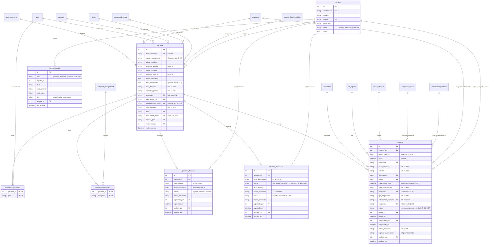

# Modelo entidad-relación, borrador

Versión 2, 2026-10-20. Borrador del equipo para el entregable de la guía [3.6] ("El Diagrama
Entidad-Relación (E-R) de la base de datos como archivo adjunto o dentro del repositorio"). Sale de
las historias del backlog v3 (alcance 1 a 23 del anexo, D-16). Los diagramas están en Mermaid, que
GitHub dibuja solo dentro de un archivo .md; las imágenes PNG están en la misma carpeta.

## Resumen

- **24 tablas**: 8 del núcleo clínico y de seguridad, 14 catálogos y 2 para mantener los catálogos.
- Los 14 catálogos salen de la regla [2.3]: "Todos los campos que contienen más de 5 opciones
  seleccionables deben tener una entidad propia en la base de datos". Son los 12 de las historias,
  más el CIE-10 y los departamentos, que llegan en el mismo archivo de la DIVIPOLA.
- Los campos con 5 opciones o menos (sexo, identidad de género, zona, grupo de servicios, entorno,
  clasificación del triage, tipo de diagnóstico, Sí o No) no son tablas: son columnas con una lista
  cerrada de valores.
- Dos relaciones de muchos a muchos que pide la guía [2.1]: varias nacionalidades y varias
  discapacidades por paciente.
- Dos jerarquías padre e hijo: ocupaciones [2.1] y CIE-10 [2.2], cada una con una llave hacia su
  misma tabla.
- La oposición y la voluntad anticipada son "estructura separada" [2.1]: cada una es una tabla con
  una fila por versión.
- Nada se borra (D-20): los catálogos tienen estado; las versiones de la oposición y la voluntad
  tienen estado; una atención registrada por error queda "Anulada" (D-27); los cambios quedan en dos
  tablas de historial.
- En las dos jerarquías el padre se lee del código (D-26): 2221 está bajo 222; A000 bajo A00. Por eso
  no puede haber ciclos.

## Tablas

| Tabla | Para qué | Historias |
|---|---|---|
| usuario | Personas que ingresan, con su cargo. Las crea el equipo técnico al instalar [2.4] | HU-001 |
| paciente | Datos del paciente, numerales 1 a 15 menos los que van aparte | HU-004 a HU-006 |
| paciente_nacionalidad | Una fila por nacionalidad del paciente [2.1] | HU-004 a HU-006 |
| paciente_discapacidad | Una fila por categoría de discapacidad del paciente [2.1] | HU-004 a HU-006 |
| oposicion_donacion | Numeral 8: una fila por versión (vigente, anterior o anulada) | HU-010 a HU-013 |
| voluntad_anticipada | Numeral 9: una fila por versión, con el evento de la fecha | HU-014 a HU-017 |
| atencion | Numerales 16 a 23, la ocupación del momento (D-24) y su estado: borrador, registrada o anulada (D-08, D-27) | HU-007 a HU-009 y HU-043 |
| historial_cambio | Actualizaciones y correcciones de paciente, atención, oposición y voluntad, con el dato anterior y el nuevo (RC-6) | HU-006, HU-008, HU-009, HU-011, HU-012, HU-015, HU-016 |
| pais | Numerales 1 y 11 | HU-018 |
| tipo_documento | Numeral 2 | HU-034 |
| ocupacion | Numeral 7, con su grupo leído del código (D-26) | HU-022 |
| departamento | Llega con la DIVIPOLA; agrupa los municipios | HU-026 |
| municipio | Numeral 12 | HU-026 |
| categoria_discapacidad | Numeral 10 | HU-035 |
| etnia | Numeral 13, componente etnia | HU-036 |
| comunidad_etnica | Numeral 13, componente comunidad | HU-037 |
| entidad_plan_beneficios | Numeral 15 | HU-038 |
| modalidad | Numeral 18, componente modalidad | HU-039 |
| via_ingreso | Numeral 20 | HU-040 |
| causa_atencion | Numeral 21 | HU-041 |
| enfermedad_huerfana | Numeral 23, código de enfermedad huérfana | HU-042 |
| diagnostico_cie10 | Numeral 23, diagnóstico principal, con su categoría leída del código (D-26) | HU-030 y HU-031 |
| catalogo_version | Cada carga de un archivo oficial: fuente, dirección y fecha de descarga, versión, fecha de publicación y conteos (RC-8, RC-9) | Todas las de catálogo |
| catalogo_cambio | Cada creación, cambio de nombre, inactivación o reactivación de un valor, con motivo (RC-10) y referencia | Todas las de catálogo |

## Columnas con lista cerrada (no son tablas)

| Columna | Valores | Numeral |
|---|---|---|
| paciente.sexo_biologico | 01 a 03 | 5 |
| paciente.identidad_genero | 01 a 05 | 6 |
| paciente.zona_territorial | 01 y 02 | 14 |
| atencion.grupo_servicios | 01 a 05 | 18 |
| atencion.entorno | 01 a 05 | 19 |
| atencion.triage_clasificacion | 01 a 05 | 22 |
| atencion.tipo_diagnostico | 01 a 03 | 23 |
| oposicion_donacion.manifestacion, voluntad_anticipada.tiene_documento | 01 Sí y 02 No | 8 y 9 |
| voluntad_anticipada.evento | Suscripción, modificación, sustitución, revocación | 9 (inferencia del equipo) |
| usuario.cargo, estados de atención y de versiones, motivos de inactivación y de anulación | Listas del sistema | Tanda 0, D-08, D-27, RC-10 |

## Reglas que el modelo tiene que cumplir

- Los códigos se guardan como texto con su longitud y sus ceros iniciales (D-18): 05001, no 5001.
- `paciente`: tipo y número de documento son únicos juntos (D-07).
- `atencion.diagnostico` solo acepta códigos de `diagnostico_cie10` con `elegible = sí`, que son los de
  4 caracteres (D-22). Puede quedar vacío mientras la atención es borrador (D-08).
- Una atención anulada guarda el motivo, quién y cuándo (D-27) y no acepta correcciones.
- `atencion.codigo_prestador` lo pone el sistema con el código de la IPS configurado al instalar
  (D-05); no hay tabla de prestadores. `voluntad_anticipada.codigo_prestador` se escribe y se valida
  con 12 caracteres.
- Los catálogos solo ofrecen valores con estado activo (RC-2). Un valor inactivo sigue referenciado
  por los registros que ya lo usan (RC-4).
- `ocupacion.padre` es el código sin su último carácter y `diagnostico_cie10.padre` son sus 3 primeros
  caracteres (D-26). El sistema lo calcula al cargar, así que no puede haber ciclos. Ningún valor
  activo queda bajo un padre inactivo.
- `version_id` de cada catálogo es la última versión cuyo archivo oficial trajo el código, aunque su
  fila se haya rechazado. Si es la vigente, el código está en la versión vigente, que es lo que miran
  "Creado por error" y la reactivación (RC-10).
- Nombre del momento del registro (RC-11, D-25): los registros guardan solo el código. El nombre que
  tenía el valor en la fecha del registro sale de `catalogo_cambio` (el último cambio de nombre
  anterior a esa fecha), así el nombre no se repite en cada registro.
- `historial_cambio` guarda la tabla y el número del registro que cambió. Esa referencia no es una
  llave foránea de la base de datos: la valida el sistema. Es la forma más simple de tener un solo
  historial para cuatro tablas; la otra opción es una tabla de historial por cada una.

## Diagrama 1. Núcleo clínico

Los catálogos aparecen sin columnas; las columnas están en el diagrama 2.

## Diagrama 2. Catálogos y su mantenimiento

Todos los catálogos tienen `estado` (activo o inactivo) y `version_id`, la última versión del archivo
oficial que trajo el código.

```mermaid
erDiagram
    catalogo_version {
        int id PK
        string catalogo
        string version
        date fecha_publicacion
        string fuente
        string direccion_descarga
        date fecha_descarga
        int filas_leidas
        int filas_aceptadas
        int filas_rechazadas
        int cargado_por FK
        datetime cargado_en
    }
    catalogo_cambio {
        int id PK
        string catalogo
        string codigo
        string tipo "creado, nombre, inactivado, reactivado o reemplazado"
        string valor_anterior
        string valor_nuevo
        string motivo "lista de RC-10"
        string referencia_oficial
        string codigo_reemplazo "si es Reemplazado por"
        int version_id FK
        int usuario_id FK
        datetime fecha_hora
    }
    usuario {
        int id PK
        string nombre
        string cargo
    }
    pais {
        string codigo PK "3 digitos (D-03)"
        string nombre
        string estado
        int version_id FK
    }
    tipo_documento {
        string codigo PK "2"
        string nombre
        string estado
        int version_id FK
    }
    ocupacion {
        string codigo PK "1 a 4; se registran las de 4"
        string nombre
        string padre FK "codigo sin su ultimo caracter (D-26)"
        string estado
        int version_id FK
    }
    departamento {
        string codigo PK "2"
        string nombre
        int version_id FK
    }
    municipio {
        string codigo PK "5, con el cero inicial"
        string nombre
        string departamento FK
        string estado
        int version_id FK
    }
    categoria_discapacidad {
        string codigo PK "2"
        string nombre
        string estado
        int version_id FK
    }
    etnia {
        string codigo PK "2"
        string nombre
        string estado
        int version_id FK
    }
    comunidad_etnica {
        string codigo PK "3"
        string nombre "lo traeria el catalogo (por verificar)"
        string estado
        int version_id FK
    }
    entidad_plan_beneficios {
        string codigo PK "6"
        string nombre
        string estado
        int version_id FK
    }
    modalidad {
        string codigo PK "2"
        string nombre
        string estado
        int version_id FK
    }
    via_ingreso {
        string codigo PK "2"
        string nombre
        string estado
        int version_id FK
    }
    causa_atencion {
        string codigo PK "2"
        string nombre
        string estado
        int version_id FK
    }
    enfermedad_huerfana {
        string codigo PK "1 a 4 (D-14)"
        string nombre
        string estado
        int version_id FK
    }
    diagnostico_cie10 {
        string codigo PK "3 o 4"
        string nombre
        string padre FK "3 primeros caracteres (D-26)"
        bool elegible "solo los de 4 (D-22)"
        string estado
        int version_id FK
    }
    ocupacion |o--o{ ocupacion : "padre de"
    diagnostico_cie10 |o--o{ diagnostico_cie10 : "padre de"
    departamento ||--o{ municipio : "contiene"
    usuario ||--o{ catalogo_version : "carga"
    usuario ||--o{ catalogo_cambio : "hace"
    catalogo_version ||--o{ catalogo_cambio : "trae"
    catalogo_version ||--o{ pais : "version"
    catalogo_version ||--o{ tipo_documento : "version"
    catalogo_version ||--o{ ocupacion : "version"
    catalogo_version ||--o{ departamento : "version"
    catalogo_version ||--o{ municipio : "version"
    catalogo_version ||--o{ categoria_discapacidad : "version"
    catalogo_version ||--o{ etnia : "version"
    catalogo_version ||--o{ comunidad_etnica : "version"
    catalogo_version ||--o{ entidad_plan_beneficios : "version"
    catalogo_version ||--o{ modalidad : "version"
    catalogo_version ||--o{ via_ingreso : "version"
    catalogo_version ||--o{ causa_atencion : "version"
    catalogo_version ||--o{ enfermedad_huerfana : "version"
    catalogo_version ||--o{ diagnostico_cie10 : "version"
```

Los nombres de los diagramas van sin tildes porque Mermaid no siempre las acepta en etiquetas.

## Lo que queda abierto

| Tema | Efecto en el modelo | Decisión |
|---|---|---|
| Alcance 1 a 49 | Si el docente lo confirma, entran las tablas de tecnologías en salud, egreso, valoración, antecedentes y factores de riesgo, y entre 2 y 6 catálogos más (plan B) | D-16 |
| Código de país alfabético o numérico | Propuesta: numérico (170). Cambia el ejemplo, no el modelo: el código es texto de 3 | D-03 |
| Varias sedes | Si la IPS tiene más de una sede, aparece una tabla de sedes y `atencion` apunta a ella | D-05 |
| Historial único o por tabla | Una tabla de historial por cada tabla clínica da llaves foráneas reales a cambio de cuatro tablas más | Propuesta de este borrador |
| Nombre del momento del registro | Propuesta: se deriva de `catalogo_cambio`. La otra opción es guardar una copia del nombre junto a cada código en los registros: más columnas, consultas más simples | D-25 |
| Estructura de los archivos oficiales | Si la CIUO-88 no arma sus códigos por prefijo, `ocupacion.padre` vuelve a llegar en el archivo; si la tabla CIE10 de SISPRO no trae las categorías de 3, se cargan de la CIE-10 adoptada (supuesto de HU-030) | D-26 |

## Registro

| Fecha | Versión | Cambio |
|---|---|---|
| 2026-10-20 | 1 | Primer borrador desde las historias del backlog v3 |
| 2026-10-20 | 2 | Revisiones de las tandas 4 y 5: anulación de la atención (HU-043, D-27); padre leído del código (D-26); dirección y fecha de descarga de cada versión; `version_id` como última versión que trajo el código (RC-10); nombre del momento del registro (D-25); cargo profesional de estadística; `diagnostico_cie10.descripcion` pasa a `nombre`, como en el anexo |
| 2026-10-20 | 2 (continuación) | Revisión final cruzada: `version_id` cuenta los códigos de filas rechazadas; sale la cita de [2.7] |
| 2026-10-20 | 2 (verificación) | Verificación de la aplicación: el nombre de la comunidad étnica lo traería el catálogo, que está por verificar; filas del registro en orden |
